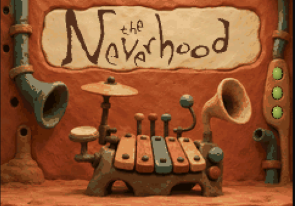

# FM-1 Neverhood



FM-1 firmware: 22 presets, a four-track sequencer, and a battery indicator.

Built on [fm1-base](https://github.com/charlesvestal/fm1-base).

Try in emulator: https://neverhood.moode.ru/emu/
Install: https://neverhood.moode.ru/

```sh
./setup.sh
./run.sh
```

A tribute to The Neverhood (1996). Characters and some sounds and sprites come from the game's demo files and belong to their creators.
